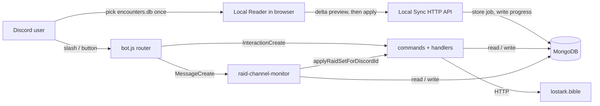

# Artist - Lost Ark Raid Management Bot


**Artist** tracks a Lost Ark guild's weekly raid progress in place of shared spreadsheets. It
syncs each member's roster from `lostark.bible`, records gate clears from chat posts, commands
or the clear logs, shows who still owes which raid, and resets the guild every Wednesday at
17:00 VN. Every surface is in Vietnamese, Japanese and English.

It also ships a **zero-upload Local Reader** that reads `encounters.db` on the user's device and
writes new clears when they press Sync on the page; the raw database never leaves the browser.
Side tasks, weekly gold and an auction-bid calculator round out the raid week.

**Contents:** [Features](#features) · [Commands](#commands) · [How it works](#how-it-works) ·
[Text monitor](#text-monitor) · [Raid log capture](#raid-log-capture) · [Data](#data) ·
[Architecture](#architecture) · [Setup](#setup) · [Known limitations](#known-limitations)

## Features

- **Rosters** from `lostark.bible`, picked character by character (up to 20 per roster), refreshed daily.
- **Progress** per character and gate in `/raid-status`, with a Raid Manager scan in `/raid-check`.
- **Four ways to record clears**: chat posts in the monitor channel, `/raid-set`, Bible clear-log auto-sync, or the Local Reader.
- **Side tasks** per character and shared tasks per roster, reset daily and weekly.
- **Gold**: weekly gold per character and account with the bound/unbound split, and the six gold earners per account.
- **Auction calculator**: bids for 4- and 8-player parties from one listing price.
- **Public log capture**: `/raid-log` shows a character's latest public log as images.
- **Schedules**: weekly reset (catch-up safe), monitor-channel cleanup every 30 minutes, 11 announcement types, and Artist's quiet hours 02:00-09:00 VN.
- **Sharing**: Raid Managers can share their rosters with another user.
- **Languages**: per-user Tiếng Việt (default) or 日本語; help in vi / jp / en.

## Commands

Replies are private (ephemeral) unless a row says otherwise.

| Command | Who | What |
|---|---|---|
| `/raid-add-roster` | anyone (self); Raid Manager (`target:` for others) | Fetch a roster from `lostark.bible` and pick the characters to save (up to 20; the picker session lasts 5 minutes) |
| `/raid-edit-roster` | anyone (self) | Re-fetch a saved roster and add or drop characters in one picker (✅/🆕/➖/⬜); raid progress is kept |
| `/raid-remove-roster` | anyone (self) | Remove a roster or one character from it |
| `/raid-status` | anyone (self) | Progress card with four views: 📋 Raid · 📝 Side tasks · 💰 Gold & difficulty · 🗃️ Local Sync |
| `/raid-set` | anyone (self); Raid Manager (rosters they registered) | Update one character: `complete` / `process <gate>` / `reset`. Rosters a manager registered show 👥 in autocomplete |
| `/raid-check` | Raid Manager | Scan rosters for pending characters from iLvl 1720 up, with **Sync-check all** |
| `/raid-auto-manage` | anyone (self) | `on` / `off` / `sync` / `status` for Bible auto-sync · `local-on` / `local-off` for Local Sync · `reset` your own progress and sync state (two-step confirm) |
| `/raid-task` | anyone (self) | Side tasks per character and shared tasks per roster |
| `/raid-gold-earner` | anyone (self) | Choose which characters earn gold (6 per account per week) |
| `/raid-auction` | anyone (self) | Bid calculator for 4- and 8-player parties; replies publicly, input errors stay private |
| `/raid-bg` | anyone (self) | Background images for your `/raid-status` cards |
| `/raid-log` | anyone | A character's latest public log as images ([Raid log capture](#raid-log-capture)) |
| `/raid-share` | Raid Manager | `grant` / `revoke` / `list` sharing of all your rosters with another user |
| `/raid-language` | anyone (self) | Your display language: 🇻🇳 Tiếng Việt (default) or 🇯🇵 日本語 (a cuter Artist voice) |
| `/raid-help` | anyone | Drill-down help; `language:` overrides the language for one call (vi / en / jp) |
| `/raid-channel` | admin | Register the monitor channel, toggle schedules, repin the welcome |
| `/raid-announce` | admin | List, enable, disable or redirect the 11 announcement types per guild |
| `/raid-server` | bot owner | `list` the servers Artist is in, or `leave server:` one (see [Access](#access-and-sharing)) |

**Raid Manager** = a Discord user ID in `RAID_MANAGER_ID` (comma-separated). Managers get a 15 s
auto-sync cooldown (10 minutes for others), a `👑` header icon on their rosters, `/raid-check`,
and `/raid-share`.

## How it works

### Raid status

- One roster per page. The 🗃️ Local Sync view is always listed, since Discord cannot disable a single select option; with no sync mode on it shows a "turn it on" card.
- Roster iLvl and class refresh in the background and from the **Refresh roster** button. A refresh follows a character renamed in game to its new name by its `lostark.bible` character id and keeps its progress; the roster card notes the old name for a week, and any character that is new on the roster without being added. Bible auto-sync may record the renamed character's clears one sync later.
- **Gold & difficulty**: weekly gold per character and per account, bound gold in the `🔒` tail; per-character gold is hidden while a raid filter is active. The view edits one or several characters at once (✏️ marks the selection):
  - the gold dropdown pins up to 3 gold raids (3 ticked set exactly those; fewer leave the free slots to Artist), and 🔄 **Reset gold** returns them to automatic;
  - the difficulty dropdown sets raid modes, which apply at once before a raid has run and queue for the next weekly reset after it ran;
  - each save posts one summary;
  - ⚙️ **Raid visibility** opens a page where an unticked raid is hidden (💤) from the Raid tab and `/raid-check` while a shown one is marked 🔹; its gold is unchanged, the choice stays across weekly resets, and 🔄 **Show all** brings every raid back.
- `/raid-gold-earner` pre-checks the top 6 by iLvl the first time for older data; new characters default to on.

### Sync

| Mode | How it records clears |
|---|---|
| Bible auto-sync (`/raid-auto-manage action:on`) | Reconciles clears from `lostark.bible` logs; cannot reach characters with Public Log off |
| Local Sync (`action:local-on`) | The Local Reader reads the active raid week from `encounters.db`; new links come from `/raid-status` → 🗃️ Local Sync |
| Solo Local Reader | For Bible auto-sync users: a private link from `/raid-status` that syncs only explicit Solo clears from the page |

- **Bible and Local Sync exclude each other**, even when the mode changes during a running sync or a save retry. A failed Discord acknowledgement releases the sync slot.
- **The Local Reader page** remembers the file handle, watches SQLite revisions in near real time (sub-500 ms visible fallback), drops superseded scans, and checks the file header right before sending a small delta preview; changed files settle and rebuild first.
- **Sync** stores the preview as a short-lived job and applies it in a second call, so a retry after a transient write error reuses the job and keeps party propagation for gates already written. Preview jobs last 2 hours, a newer scan supersedes an older pending preview, and an interrupted apply recovers automatically. A pending preview can still be Synced, Cancelled or Refreshed from `/raid-status`. Reader links last 30 minutes, also after a web sync. A public card never carries the signed link: its **New link** button sends it in a private follow-up.
- **Solo scope**: the Solo link accepts only rows whose local difficulty is explicitly `Solo`. The page, the preview endpoint and the apply endpoint all enforce it, so a Solo link cannot apply a Full job; unknown, empty or non-Solo difficulties are never guessed into Solo. The Solo reader never propagates party progress.
- **Party propagation** (Full Local Sync only): an encounter's cumulative gate progress is also written to party characters registered in any Artist roster, whatever their owner's sync mode, but only while the target raid has no progress this week; the synced card lists them. Party membership comes from the client-readable `players` snapshot and is not attested by Artist, so the server caps each source gate at 15 targets, applies the source gate first, and re-checks untouched progress before every write.
- **Daily roster refresh** opens at 00:00 VN for every registered roster, Local Sync included. It drains up to six users every five minutes with restart catch-up, at most four attempts per user per day, and spaces refreshes 1.5 s apart; on a `lostark.bible` 429 it pauses until the backoff ends and the interrupted user keeps the attempt. It refreshes roster data in every mode; clear-log reconciliation still needs `action:on`, and Local Sync clears still need the Local Reader. The `daily-roster-sync` summary rides the next raid-channel cleanup notice (or the morning greeting during quiet hours); a guild without channel cleanup, or with its own channel set for it, gets a separate post. `AUTO_MANAGE_DAILY_DISABLED` switches the scheduler off.
- **Reset** (`/raid-auto-manage action:reset`) also clears the daily scheduler's lease and retry state; a new daily attempt has its own identity, so an older worker cannot overwrite it.

### Raid check

`/raid-check` lists pending characters from iLvl 1720 up; lower characters stay out of its cards,
counts and roster pages, and Solo raids stay hidden because a solo clear needs no team.
**Sync-check all** sits on the button row in every view and pulls Bible logs for every raid and
every saved roster whose owner turned auto-sync on (Local Sync users are skipped); reopen
`/raid-check` afterwards to see the update. **Refresh roster** pulls iLvl and class for the current
roster. Characters sit in their natural iLvl bucket (Serca Normal `[1710,1730)`, Hard
`[1730,1740)`, Nightmare `1740+`), and an explicit clear also shows on the mode it was cleared
in, marked when seen from another bucket, e.g. `2/2 (Normal Clear)`.

### Side tasks

- **Per character**: daily and weekly tasks (up to 3 daily + 5 weekly); `add` with `action:single` or `all`, `remove`, `clear`.
- **Shared per roster**: Event Shop, Chaos Gate, Field Boss or custom presets (up to 5 daily + 5 weekly + 5 scheduled); `shared-add all_rosters:true` adds to every saved roster; `expires_at:YYYY-MM-DD` hides an expired event shop.
- Ticked in `/raid-status` → 📝 Side tasks. They reset at 17:00 VN daily and Wednesday 17:00 VN weekly. Scheduled presets (Chaos Gate Mon/Thu/Sat/Sun, Field Boss Tue/Fri/Sun) follow 11 AM-5 AM US Eastern windows, daylight saving included, so they open an hour later in VN during US winter time.
- Writes to a shared roster recheck edit access before each save attempt and stay bound to the original owner, so a revoked grant cannot finish a pending retry.

### Schedules and announcements

- **Weekly reset**, Wednesday 17:00 VN: checked every 30 minutes (Wednesday ≥ 10:00 UTC), once per user through `weeklyResetKey` (ISO week); a bot that was offline through the window resets on its next check.
- **Monitor-channel cleanup** every 30 minutes. During Artist's quiet hours (02:00-09:00 VN, with a bedtime and a morning catch-up sweep) her scheduled posts stay quiet: Chaos Gate / Field Boss and maintenance reminders, the weekly reset and the daily roster report. Something due at exactly 02:00 or 09:00 still posts.
- **Announcement types** (`/raid-announce`): `daily-roster-sync`, `weekly-reset`, `stuck-nudge`, `set-greeting`, `hourly-cleanup`, `artist-bedtime`, `artist-wakeup`, `whisper-ack`, `maintenance-early`, `maintenance-countdown` and the opt-in `world-event-reminder`, which posts 20 minutes before Chaos Gate or Field Boss, names whichever spawns and combines Sunday overlaps.

### Auction calculator

`/raid-auction market_value:<AH listing>` (with optional `profit`, on by default) shows the bids
for 4- and 8-player parties side by side, each member's cut and the winner's estimated profit.
Enter the listing price as it is: the 5% sell fee is already in the formula
`floor(0.95 × listing × (N-1)/N)`, × 0.92 in profit mode (ported from la-utils).

### Backgrounds

`/raid-bg` needs no admin setup or environment variable. Uploads are normalized to a 16:9
(1600×900) JPEG of at most 2 MB and stored in the `userbackgrounds` collection.
- `set` adds 1-4 images: `action:overwrite` replaces the library, `extend` appends, up to 6 scenes.
- `view` browses one scene at a time with a dropdown and ◀/▶.
- `edit` replaces a scene or deletes scenes.

Saved images map evenly or randomly across your rosters (extra scenes are spares). Shared roster
pages use the viewer's own backgrounds, not the owner's.

### Access and sharing

- **`/raid-share grant target:@user`** (default `permission:edit`): the grantee reads and writes the manager's rosters in `/raid-status`, `/raid-set`, `/raid-task` and the text monitor. Adding, editing and removing rosters and `/raid-auto-manage` stay with the owner. Revocable any time.
- **`/raid-server`** is for the Discord application owner and shown only to admins. `leave` asks for confirmation on a card (60 s); the `server` option suggests server names; the home server (`GUILD_ID`) is refused, and nothing saved about a server is deleted. It is not listed in `/raid-help`.

## Text monitor

Post into the channel registered with `/raid-channel`:

```text
Serca Nightmare Clauseduk            → mark all Serca Nightmare gates done
Kazeros Hard Soulrano G1             → mark G1 only (cumulative: G_N also marks G1..G_{N-1})
Act4 Solo Priscilladuk                → mark all Act 4 Solo gates done
Act4 Hard Priscilladuk, Nailaduk     → multi-char in one post
Act4 reset Priscilladuk               → reset all Act 4 gates while preserving its stored mode
Kazeros done Priscilladuk             → mark Kazeros done in the mode the character already has
```

The bot parses the post, updates the characters and confirms by DM. Aliases are case-insensitive:

| Kind | Values |
|---|---|
| Raid | `act 4` / `act4` / `armoche` · `kazeros` / `kaz` · `serca` (typo `secra`) · `horizon` / `cathedral` / `hc` · `belgardin` / `belg` |
| Difficulty | `solo` (Act 4/Kazeros/Serca/Belgardin only) · `normal` / `nor` / `nm` / `level 1` / `l1` · `hard` / `hm` / `level 2` / `l2` · `nightmare` / `9m` / `level 3` / `l3` |
| Gate | `G1`, `G2`, ... (validated per raid) |
| Reset | `reset` / `rs` (whole raid; no difficulty or gate) |
| Done | `done` in place of the difficulty: each character's raid is marked in the mode it already has (a raid with no stored mode uses the one `/raid-status` shows), so the mode never changes; a gate still works; no difficulty or `reset` beside it |
| Separator | space, `+`, or `,` |

`nm` is Normal, not Nightmare; Nightmare takes only the full word or `9m`. Horizon uses Level
1/2/3 and has no Solo. A typed Level 1/2 still records, but `/raid-set` autocomplete and the
`/raid-status` difficulty picker offer Horizon Level 3 only, and a character below 1750 no longer
gets Horizon by default.

## Raid log capture

Experimental: it depends on `lostark.bible`'s current layout and access policy.

### Using it

- `/raid-log` opens a character picker only the caller can use: **🔎 Search by name**, a menu of the caller's own saved characters (class icon, roster, item level), and **🕘 Recent logs**. Users with no saved characters see only the name search. Other users' shared or manager-accessible rosters are not offered, and a roster choice is checked against the owner's current characters first.
- A character opens their latest public NA log by encounter time, with no weekly filter and no roster registration or auto-sync needed. The name must match exactly (case-insensitive, accents kept); private logs, unknown characters, no logs and mismatched identities get a notice card.
- **The panel** is a log book titled with the raid and character and linked to the log on Bible. The DPS row names 👑 MVP DMG, 📈 DPS score and 🎯 MVP Counter; the support row names ✨ MVP Sup, 🤝 Sup contribution and ⏱️ Sup uptime. The raid's five latest logs follow, coloured by parse tier, with ▶ on the open one.
- **Controls**: **◀️ tab ▶️ · 📐 Bracketed/Normalized · ↩️ Defaults**, then menus for raid, log, player and tab. The raid menu holds **⏬ Load older logs** (one more page at a time, up to 250 logs) and **🔄 Refresh** (reloads and recaptures, bypassing cached images). A click answers at once with a waiting line, and a second click on the same panel starts no second job. Only the caller can operate the panel, for 15 minutes; others can view it or open their own.
- **Tabs**: the team view has Damage, Party/Self Buffs, Shields, Tanked, Average DPS and 10s DPS; a player view has Skill Damage, Party/Self Buffs and Damage Breakdown, as two images covering the whole page. Switching logs resets the player focus to the team.
- **🕘 Recent logs** shows the ten newest fights across the caller's saved characters (the 24 highest item levels) and lists characters whose logs are private; its menu opens any of the newest 25. Results are kept five minutes per caller; a gathering stops at 45 seconds and shows what arrived.
- One log is one gate, not a whole-raid aggregate, and anonymized names stay as Bible shows them. It never updates raid progress. Every problem gets a private notice card; a failed capture links the log on Bible, and a character whose logs turn private mid-session gets a lock card.

### Running it

- Only HTTPS public log URLs on `lostark.bible` are accepted. Captures run in an isolated, signed-out Playwright Chromium Headless Shell that may load only same-origin requests and images from `cdn.ags.lol`.
- One capture runs per process with up to four queued, all inside a 60-second deadline; a crashed browser gets one fresh attempt within it. Catalog lookups (profile and history pages) have their own 30-second budget. Images are kept in a 16 MiB LRU cache for 5 minutes; captures over 8 MiB are errors. The render log records the queue, capture and Discord upload times.
- The browser is reused for up to 45 idle seconds when memory permits. With a cgroup memory limit, Chromium closes before framing when free memory is under a 128 MiB reserve plus the largest bitmap pair; this lowers peak memory but is not an OOM guarantee.
- The bot needs **Embed Links** and **Attach Files** in the target channel. Docker installs the headless shell at build time; other Linux hosts need `npx playwright install --with-deps --only-shell chromium` ([Playwright docs](https://playwright.dev/docs/browsers#chromium-headless-shell)).
- A local try without Discord or MongoDB (it fetches the public site and writes PNG + JSON to `.agent/raid-log-preview/`). A local success says nothing about Railway memory, Linux rendering or Discord delivery.

```powershell
npm ci
npx playwright install --only-shell chromium
npm run preview:raid-log -- --character Qiylyn
```

## Data

| Model (collection) | Holds |
|---|---|
| `users` (`User`) | One document per Discord user: accounts, characters and each character's raid progress |
| `GuildConfig` | Per-guild monitor channel, cleanup cursors, bedtime/wake-up dedup keys and announcement settings |
| `LocalSyncPreview` | Local Sync preview jobs (expire on their `expiresAt`) |
| `roster_shares` (`RosterShare`) | Roster shares from a manager to a grantee |
| `userbackgrounds` (`UserBackground`) | `/raid-bg` images, apart from the user document |

```jsonc
{
  "discordId": "390361918071635968",
  "weeklyResetKey": "2026-W17",
  "autoManageEnabled": true,
  "accounts": [
    {
      "accountName": "Clauseduk",
      "lastRefreshedAt": 1745961200000,
      "characters": [
        {
          "name": "Clauseduk",
          "class": "Paladin",
          "itemLevel": 1743,
          "combatScore": "~4234.35",
          "publicLogDisabled": false,
          "assignedRaids": {
            "armoche": { "G1": { "difficulty": "Hard", "completedDate": 1745961111000 } },
            "kazeros": { },
            "serca":   { }
          }
        }
      ]
    }
  ]
}
```

- **Gates.** A raid is done when every official gate has `completedDate > 0` at the selected difficulty. `assignedRaids.<raidKey>` uses `strict: false`, so a new gate needs no migration.
- **Solo mode.** Raids with a Normal difficulty carry a manual-only `solo` mode: same item-level floor and gold as Normal, its own stored key and label. Automatic eligibility never picks it, and level-based content such as Horizon has none. A mode marked `selectable: false` (Horizon Level 1/2) is skipped by every picker and the automatic default but stays in the catalog, so stored modes, typed input and synced clears still count. A Solo raid that holds no gold slot this week stays on its `/raid-status` card with `🔒` but is left out of every count, so the dropdowns and the header agree.
- **Classes.** 30+ classes map from Bible ids to display names in `bot/models/Class.js`; an unknown id falls back to the title-cased raw id.

## Architecture

```
LostArk_RaidManage/
|-- bot.js            # Discord client lifecycle and listeners
|-- bot/
|   |-- commands.js   # Composition root: wires every command and service factory
|   |-- db.js         # Lazy Mongo connection with DNS fallback
|   |-- app/          # Boot: slash registration, Local Reader server, router registry
|   |-- domain/       # Static catalog data (raids, gold, difficulty aliases)
|   |-- handlers/     # commands, local-sync, meta, raid, raid-check, raid-status, roster
|   |-- models/       # Schemas (user, guildConfig, localSyncPreview, RosterShare, userBackground) and class/emoji metadata
|   |-- services/     # access, auto-manage, discord, i18n, local-sync, raid (schedulers, reset, monitor), roster
|   `-- utils/        # async (in-flight loader, latest-only queue), discord, raid (common, queries, schedule, tasks)
|-- web/              # Local Reader page (ES modules)
|-- assets/           # class-icons, artist-icons
|-- scripts/          # deploy-commands.js (manual slash registration), invert-icon.py
|-- test/             # node --test suite
`-- Dockerfile, railway.toml, .env.example, package.json
```

1. **Factory and dependency injection.** Every command and service exports `create<Name>(deps)`, so `bot/commands.js` wires the object graph once at boot and tests pass stubs.
2. **One source of truth.** `ANNOUNCEMENT_REGISTRY`, `RAID_REQUIREMENTS` and `RAID_MANAGER_ID` each live in one place, read by help text and runtime alike.
3. **Services orchestrate, utils calculate.** DB and Discord flows stay in `services/*`; raid math and view helpers in `utils/raid/*` are shared by `/raid-status`, `/raid-check`, `/raid-task`, the schedulers and Local Sync.
4. **Shared write paths.** `applyRaidSetForDiscordId` serves `/raid-set`, the text monitor and Local Sync. Task adds and removals share `handlers/raid/task/write-handler.js` (access checks, fresh reads, save retries, replies after commit), and auto-manage confirmations share `handlers/raid/auto-manage/core/confirmation.js`.

The backend is CommonJS; `web/` keeps its own ES-module boundary.



## Setup

### Environment variables

| Var | Required | Default | Notes |
|---|:---:|---|---|
| `DISCORD_TOKEN` | ✅ | - | Bot token from the Developer Portal |
| `CLIENT_ID` | ✅ | - | Application ID for slash-command registration |
| `GUILD_ID` | ✅ | - | Home guild; slash commands are registered there |
| `MONGO_URI` | ✅ | - | MongoDB connection string |
| `MONGO_DB_NAME` | | `manage` | Database name |
| `MONGO_ENSURE_INDEXES` | | `true` | `false` when indexes are managed in the Atlas UI |
| `DNS_SERVERS` | | `8.8.8.8,1.1.1.1` | DNS fallback when the Atlas SRV lookup fails |
| `RAID_MANAGER_ID` | recommended | empty | Comma-separated user IDs; empty means `/raid-check` refuses everyone and no manager perks apply |
| `TEXT_MONITOR_ENABLED` | | `true` | `false` skips the privileged Message Content intent and the text monitor |
| `AUTO_MANAGE_DAILY_DISABLED` | | `false` | Switches off the background Bible auto-sync scheduler without a redeploy |
| `LOCAL_SYNC_TOKEN_SECRET` | for Local Reader | - | HMAC secret for the private 30-minute reader links; at least 16 characters |
| `PUBLIC_BASE_URL` | for Local Reader | - | Public HTTPS origin used to build `/sync#token=...` links |
| `LOCAL_SYNC_HTTP_DISABLED` | | `false` | `true` turns the Local Reader HTTP server off |
| `PORT` | | `3000` | Port of the Local Reader HTTP server (Railway sets it) |

The bot refuses to start when `NODE_TLS_REJECT_UNAUTHORIZED=0` is set, since that turns off
certificate checks for Discord, MongoDB and `lostark.bible`. For the text monitor, turn on
**Bot → Privileged Gateway Intents → Message Content Intent** in the Discord Developer Portal, or set
`TEXT_MONITOR_ENABLED=false` to run with slash commands only.

### Run

```bash
npm install
cp .env.example .env        # then edit with real values
npm run deploy:commands     # optional: force-register slash commands from this machine
npm start                   # or: npm run dev (node --watch)
npm test                    # node --test; there is no CI, so run it before pushing
```

### Deploy on Railway

1. Push to the GitHub branch Railway tracks and link the repo to a Railway service.
2. Set the environment variables in **Variables** (at least `DISCORD_TOKEN`, `CLIENT_ID`, `GUILD_ID`, `MONGO_URI`).
3. Railway builds from the `Dockerfile` (`node:24-bookworm-slim`, `npm ci --omit=dev`) and starts `node bot.js`; `railway.toml` restarts on failure, up to 3 times.

The bot re-registers its slash commands in `GUILD_ID` on every boot (`ClientReady` →
`applicationGuildCommands`), so a redeploy is enough for command changes. A failed registration
logs a warning and the bot keeps the previous schema; `scripts/deploy-commands.js` is for forcing
a registration from a dev machine.

## Known limitations

- `/raid-add-roster` scrapes `lostark.bible` HTML and inline SSR JSON; an upstream layout change breaks the parsers in `bot/services/roster/fetch.js`.
- Slash commands are registered in one guild (`GUILD_ID`); another server needs its own `deploy-commands` run.
- Changing `RAID_MANAGER_ID` needs a redeploy; there is no command for it.
- Bible auto-sync cannot reach a character with Public Log off. Its owner records progress with `/raid-set`, the text monitor or Local Sync; **Refresh roster** updates only iLvl and class.
- Message Content is a privileged intent: a large guild (100+ members without manual approval) needs `TEXT_MONITOR_ENABLED=false` until Discord grants access.
- Watching `encounters.db` depends on Chromium's File System Access permission. With persistent permission the reader restores and resumes on its own; otherwise it asks for one Restore click, and clearing site data means choosing the file again. A drag-and-drop file is a static snapshot. WAL-mode databases show read-only and cannot be submitted, since a single-file handle cannot prove the latest contents of `encounters.db-wal`.
- One MongoDB cluster with no sharding or read replicas; a user's footprint is small (≤ 30 characters across ≤ 5 accounts).

## License

Private project, no license.
